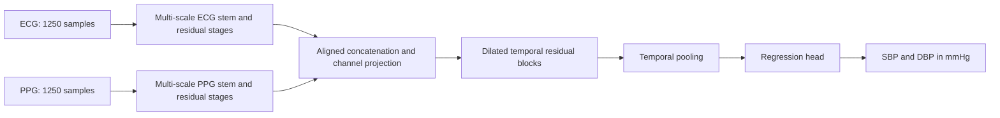

# Model V2: implementation and CRC training plan

Prepared October 9, 2026. This plan extends the [wearable system roadmap](WEARABLE_BP_OPTIMIZATION_PLAN.md) and the [implemented acquisition foundation](IMPLEMENTATION_STATUS.md). No source-data V2 training or CRC jobs have been run.

**October 11 implementation update:** the training/model foundation, pooling/SE attention candidates, CRC job entry point, evaluation/export workflow and explicit Pi bundle support are implemented on `feature/model-v2-crc-attention`. Synthetic local training verifies software contracts only; real source-data training, CUDA execution and V2 Pi measurements remain outstanding. See the [implementation and run guide](../bp_training/README.md) for the actual module layout, tested behavior and remaining dependencies. Later research/hardware stages below remain proposed.

## 1. Objective and optimization priorities

Build the most accurate practical ECG/PPG BP estimator for the intended wearable, train it on Notre Dame CRC, and deploy a verified release on Raspberry Pi. Optimize in this order:

1. Accuracy on people and wearable sessions excluded from training and model selection.
2. Useful reading coverage and performance across the pressure range.
3. Reproducibility and confidence that improvements come from the intended change.
4. Pi memory, energy, responsiveness and reliability.
5. Training throughput and resource cost.

There is no established optimal architecture for this project. Use staged experiments to find the best supported tradeoff. A larger model, more epochs or a published low error on another dataset does not establish an improvement here.

The initial interface remains two synchronized channels, ECG then PPG, 125 Hz, ten seconds, with a prediction every five seconds. Start with the existing filtered/min-max representation to isolate model changes. Final claims depend on the actual sensors, placement, reference method and calibration policy. Training compute stays on CRC; inference stays local to the Pi.

## 2. Verified starting point

| Existing behavior | Consequence for implementation |
|---|---|
| V1 is a residual CNN with 37,666 parameters | Keep it as a reproducible baseline and compare a modest capacity increase |
| V1 validation is best at epoch 3; training error continues falling through epoch 11 while validation worsens | Preserve early stopping; investigate generalization rather than assuming longer training will help |
| Official calibration-free test MAE is 12.46/8.46 mmHg SBP/DBP | Historical source-data reference; not wearable performance |
| AAMI-designated subset MAE is 19.34/13.17 mmHg, bias −12.74/−9.31 mmHg | Evaluate pressure coverage and bias; the subset name does not certify a device |
| Preparation uses the VitalDB subsets only | Broader PulseDB/source coverage is a separate, controlled experiment |
| Training selects MPS or CPU, never CUDA | A CRC GPU allocation would currently be unused |
| Training writes fixed checkpoint/report paths and saves only best model state plus metadata | Parallel jobs collide; exact training continuation is unavailable |
| The Pi application, bundle verifier and model label are hardcoded to V1 | V2 needs an explicit release/loader change, not just a replacement weight file |
| Saved Pi 4 evidence reports predictor p95 5.80 ms and peak benchmark RSS about 289 MiB | Accuracy is the first bottleneck; benchmark the full new pipeline before optimizing deployment resources |

Repository evidence: [network](../model%20training/PulseDB-based%20Model-V1/network.py), [trainer](../model%20training/PulseDB-based%20Model-V1/train_models.py), [training history](../model%20training/PulseDB-based%20Model-V1/reports/cnn_full_history.json), [metrics](../model%20training/PulseDB-based%20Model-V1/reports/METRICS.md), [saved Pi evidence](../deployment/OMEN-Codex-Prompt/implementation/EVIDENCE_SUMMARY.json), [current bundle verification](../deployment/raspberry-pi/bundle.py).

## 3. Implementation layout and boundaries

Create a new Python package, `bp_training/`, alongside the existing directories. Do not rename or modify the released V1 model implementation to develop V2. The paths below are proposed files, not existing modules.

```text
bp_training/
  cli.py                         # validate-data, train, evaluate, compare, export
  config.py                      # strict configuration validation and resolved defaults
  data/
    manifest.py                  # sources, hashes, provenance and record eligibility
    splits.py                    # participant exclusions and development folds
    dataset.py                   # lazy memory-mapped access
    sampling.py                  # optional capped pressure balancing
    augment.py                   # reproducible, timing-preserving augmentation
  models/
    registry.py                  # explicit architecture allowlist
    v1_adapter.py                # use the frozen V1 architecture
    wider_resnet.py              # capacity control
    dual_encoder_tcn.py          # proposed V2 candidate
    attention.py                 # optional channel gates and temporal pooling
  losses.py                      # standardized MSE, mmHg MSE, mmHg Huber
  trainer.py                     # device, precision, optimization and early stopping
  checkpoint.py                  # atomic best/last checkpoint and restart state
  metrics.py                     # participant and pressure-stratum metrics
  compare.py                     # eligible runs, paired comparisons, selection record
  release.py                     # inference-only artifacts and conversion checks
configs/model_v2/                 # named, reviewed JSON experiment configurations
deployment/crc/
  README.md                      # account/resource discovery and launch instructions
  preflight.py                   # environment, CUDA, storage and data checks
  run_job.sh                     # shared single-GPU entry point
  grid_engine.template           # fill verified queue/GPU resource names
  condor.template                # CAML-specific wrapper when applicable
  experiments.json               # configuration × seed run ledger
```

Keep training outputs in an explicit external `run_root`, outside public Git and outside the frozen model directory. Each run owns one directory such as `run_root/<dataset>/<config-id>/<seed>/<run-id>/`. Use strict config parsing, JSON/JSONL and the Python standard library initially; add experiment-management or distributed-training frameworks only when a measured need appears.

Define three contracts before implementation:

- **Dataset contract:** waveform representation, label units, channel order, sampling rate, subject/session/window identity, source and split eligibility.
- **Training contract:** complete resolved configuration, input hashes, seed, device/precision, objective, checkpoint/restart semantics and completion status.
- **Release contract:** allowlisted architecture/backend, inference weights, target transformation, preprocessing version, input/output schema, checksums and known limitations.

## 4. Data and evaluation design come first

Build a versioned manifest for existing arrays without copying them unnecessarily. Record source release, participant ID, session/record ID where available, waveform location, label provenance, sampling/preprocessing version and exclusions. Fit target normalization, sampling weights, quality thresholds and any learned preprocessing on the training fold only.

Retain ABP as the source of reference labels; it must never enter predictor inputs. Namespace source IDs, reconcile duplicate releases using available provenance, and fail the cross-source audit if participant duplication cannot be resolved adequately. A source prefix prevents identifier collisions but does not prove two records belong to different people.

Maintain three distinct evaluation roles:

| Role | Permitted use |
|---|---|
| Development training and validation | Architecture, optimizer, augmentation, quality and calibration selection |
| Previously examined official source tests | Historical comparison after candidate freeze; no tuning from their new results |
| Newly reserved participants, ideally prospective wearable participants | Final V2 evidence, evaluated after all decisions are frozen |

Existing test metrics have already influenced the research direction. Do not relabel those cohorts as untouched V2 evidence. Exclude their participants from new training and self-supervised pretraining. For cross-validation inside the development cohort, retrain the V1 baseline within each fold: the existing V1 checkpoint may already have trained on those people.

Keep all visits and overlapping windows from a participant together for generalization evaluation. For personalized experiments, designate early calibration records explicitly and score later records; keep these results separate from calibration-free results. Count cuff reference events and participants, not overlapping windows, when describing sample size.

The proposed ND study provides 300 planned cuff-paired records clustered within 50 participants and 100 visits, before exclusions and separately logged repeats. This is a feasibility dataset. Start adaptation with small heads or residual correction; it cannot justify unrestricted deep-model fine-tuning or strong subgroup conclusions by itself.

## 5. CRC execution and resource efficiency

CRC's general cluster documentation uses Grid Engine; CAML documents HTCondor and interactive GPU access. Confirm which resource the account can use, its actual GPU allocation syntax, storage location, walltime and environment before generating executable submission files. Use the same training entry point under either wrapper. [CRC quick-start guide](https://docs.crc.nd.edu/new_user/quick_start.html), [CAML documentation](https://docs.crc.nd.edu/resources/caml.html)

A proposed starting allocation is **one GPU, four CPU cores and 32 GiB host RAM per training job**, adjusted after profiling. Begin with a single smoke job, then a small number of independent trials within the allocation. Keep multi-GPU distributed training out of the first implementation; experiment parallelism is simpler for these model sizes. Submit training through compute-node scheduling. Record the installed GPU model, driver, PyTorch/CUDA versions and CPU allocation.

Implement a preflight report that confirms CUDA tensor operations succeed on the allocated device, verifies dataset/config hashes, checks writable run storage and available capacity, and performs a bounded training/validation pass. An explicit `device=cuda` must fail if CUDA is unavailable; never silently fall back to CPU. CPU/MPS remain explicit local development options.

Pin the working Linux/CUDA environment or container digest after the smoke run. Do not assume the existing Mac training requirements, old website example container tags or Pi inference environment are suitable for CRC. Use the scheduler's visible devices rather than guessing a physical GPU number. Keep credentials and participant data out of job logs and public artifacts.

For data loading, open memory maps lazily per worker, copy only needed batches, and profile 0/2/4 workers within the CPU allocation. Bound prefetching. Use pinned memory/nonblocking CUDA transfer where it improves measured throughput. Stage data to node-local storage only when available and beneficial; avoid every job downloading or preparing its own source archive. Publish prepared datasets atomically once, then share them read-only.

Storage planning must include originals, processed arrays, checkpoints and logs. For scale, a full 5,245,454-window, two-channel float32 tensor would itself occupy about 52.45 GB decimal, before labels or original source files. Derive the actual requirement from the selected manifest and reserve group storage accordingly. The initial VitalDB subset is much smaller. [PulseDB dataset description](https://www.frontiersin.org/journals/digital-health/articles/10.3389/fdgth.2022.1090854/full)

## 6. Reproducible GPU trainer

First reproduce the V1 training recipe through the new trainer: batch 256, AdamW, the existing target standardization, learning rate/weight decay, noise augmentation, scheduler and participant-macro selection metric. Use FP32 for this baseline. Changing batch size or precision can change optimization, so introduce those after the functional baseline is established.

Freeze these initial baseline values in configuration: learning rate `0.001`, weight decay `0.001`, additive normalized-input noise standard deviation `0.003`, gradient norm clip `5`, ReduceLROnPlateau factor `0.5`/patience `3`, early-stopping patience `8`, maximum `40` epochs and validation batch size `512`. Use seeds `20260923`, `20260924` and `20260925`; the first preserves the original seed. Record target means/scales fitted on the relevant training fold.

Required trainer behavior:

1. Accept validated configuration, dataset/split manifests, seed and unique output directory. Refuse conflicting output reuse unless explicitly resuming a compatible run.
2. Seed Python, NumPy, the explicit NumPy generator, Torch CPU/CUDA and data workers. Use deterministic per-epoch sample/augmentation seeds where practical. Record nondeterministic operations; do not promise identical retraining across GPU models.
3. Log train/validation metrics, learning rate, step/epoch, samples per second, data-wait time, epoch walltime, peak GPU memory, effective batch size, unclipped gradient norms and clipping frequency. Avoid per-batch CPU synchronization just for scalar logging.
4. Keep validation ordered, unaugmented, at natural prevalence and outside gradient tracking. Select on mean SBP/DBP participant-macro MAE in mmHg. Never select on training loss.
5. Maintain early stopping and a fixed maximum training budget. A larger model can need a different learning rate, but its tuning budget must be comparable with competing architectures.
6. Support mixed precision as an explicit experiment: BF16 when the allocated device supports it; FP16 with gradient scaling when appropriate. Unscale FP16 gradients before clipping. Evaluate the precision choice against FP32 accuracy and stability. [PyTorch AMP recipe](https://docs.pytorch.org/tutorials/recipes/recipes/amp_recipe.html)

Save separate **last** and **best** checkpoints using a temporary file and atomic replacement on the same filesystem. Checkpoints must include model, optimizer, LR scheduler, applicable AMP scaler, epoch/global step, best score, early-stopping counters, all RNG state, sampler state, resolved config, code revision and dataset/split hashes.

Implement trustworthy epoch-boundary resume first. A checkpoint saved after epoch `k` restores that completed state and starts epoch `k+1`. If epoch `k+1` was interrupted, repeat its unfinished work from that boundary; this is not exact mid-epoch continuation. Never overwrite the epoch-boundary `last` checkpoint with partially completed epoch state. Signal handlers set a shutdown flag, and the training loop exits at a safe point. Do not claim safe resumption from a checkpoint missing optimizer/scheduler/RNG state. Save the durable boundary checkpoint every epoch so a hard kill does not lose the entire run.

Mark each run as initialized, running, completed, interrupted or failed. Only compatible completed runs enter comparisons. A failed run's last metric must not be mistaken for a converged result. Store full training checkpoints privately; deploy inference-only weights and metadata.

## 7. Model candidates and concrete V2 design

Implement three architectures first: exact V1, a wider conventional V1-style residual network, and a separate-encoder temporal model. Aim for roughly **0.3–1.0 million parameters** for the proposed V2, then record actual parameter count, operation count, activation sizes and target-runtime support. This is a search range, not a required minimum size or a proven optimum.



A concrete starting specification:

| Stage | Proposed definition | Output per example |
|---|---|---|
| Input | ECG/PPG split; same normalization as V1 | Two `1 × 1250` streams |
| Each stem | Parallel stride-1 kernels 5/15/31 with padding 2/7/15, 16 channels each; concatenate and project to 32 | `32 × 1250` per stream |
| Each residual stage 1 | 64 channels; kernel 5/stride 2 then kernel 3/stride 1, with projected shortcut | `64 × 625` per stream |
| Each residual stage 2 | 96 channels; kernel 5/stride 2 then kernel 3/stride 1, with projected shortcut | `96 × 313` per stream |
| Fusion | Concatenate corresponding time positions, 1×1 projection | `128 × 313` |
| Temporal stack | Six residual blocks, width 128, two depthwise-separable kernel-5 convolutions per block; dilations 1/2/4/8/16/32 | `128 × 313` |
| Pool and head | Global average pool initially; 128→64→2 with dropout | Two standardized outputs, converted to mmHg |

Use symmetric padding 2/1 for each residual stage's kernel-5/kernel-3 convolutions, and a kernel-1/stride-2 projected shortcut. Each kernel-5 depthwise temporal convolution uses stride 1 and padding `2 × dilation`; its pointwise projection uses kernel 1 and stride 1. These definitions preserve length at stride 1 and round length upward at stride 2. Keep identical downsampling grids for both branches. The proposed dilation stack has a theoretical receptive field spanning the ten-second window; verify this in the implementation. All inputs belong to the completed window, so no samples from later windows are needed. Maintain train/inference normalization parity and document boundary effects.

Use standard convolution, normalization, SiLU and residual operations initially. Profile an untrained instance through the intended Pi/export runtime before spending a full training budget. Batch normalization is the initial normalization choice for continuity with V1; GroupNorm and learned temporal pooling are later single-factor experiments. Depthwise convolution can reduce arithmetic without necessarily improving CPU latency, so benchmark it.

Choose the wider residual control to be reasonably close in parameter count to V2; record any mismatch. Compare capacity and architectural structure explicitly. Do not infer that a more complex fusion mechanism is useful solely because it beats the much smaller V1.

Candidate extensions, enabled only after the first campaign provides evidence:

- PPG derivatives or timing/morphology features, with their computation/version defined and source timing verified. ECG-to-PPG timing is PAT, not pure vascular transit time.
- A DBP/positive-pulse-pressure output parameterization to enforce SBP > DBP, evaluated independently. Valid ordering alone does not establish accuracy.
- ECG-only and PPG-only ablations. A deployed single-sensor product needs its own input contract; do not manufacture a missing ECG channel to satisfy V1.
- A quantile/uncertainty head, validated for held-out interval coverage and abstention behavior, not presented as a signal-quality certificate.
- Auxiliary tasks or masked-waveform pretraining on training-eligible participants only. ABP, if used as an auxiliary reference, remains a training target and is never an inference input.

### 7.1 Attention: targeted experiments before a larger Transformer

Attention could improve this model, but that is a hypothesis to test on the same participant-disjoint splits. The proposed dilated temporal stack already spans the ten-second input; attention would add input-dependent weighting or interactions, rather than supply an otherwise absent whole-window receptive field. CRC makes these experiments practical, while the selected artifact still has to meet Pi requirements.

Prioritize these options:

| Option | Proposed integration | Expected role and tradeoff |
|---|---|---|
| Learned temporal pooling | Replace the final uniform average with a learned weighted average of the `128 × 313` temporal features | Tests whether selecting informative parts of the window helps; small added model size |
| Squeeze-and-excitation (SE) channel attention | Add one feature-channel gate immediately after the 128-channel fusion projection | Reweights learned waveform features per window; a cheap starting point before adding gates throughout the network |
| Late self-attention | Later, test one residual Transformer encoder block after the TCN: width 128, four heads, feed-forward width 256, positional information and pre-LayerNorm | Enables content-dependent interactions across temporal positions; greater compute, runtime/export and tuning burden |
| ECG/PPG cross-attention | Later, augment the aligned fusion path with attention between the two encoded streams, preserving the direct aligned residual path | Could learn useful inter-signal relationships; adds timing ambiguity and complexity, so defer until simpler attention shows value |

For the first pooling implementation, use a shared `128→32→1` score network with tanh, softmax across time and a weighted sum of the original features. Initialize its final score layer to zero so training starts from uniform pooling; leave the hidden layer normally initialized. Keep the output at 128 dimensions and retain the same regression head. This adds **4,161 parameters** with biases. Start without a weighted-standard-deviation output so the ablation changes only pooling. Weighted temporal pooling has precedent in sequence modeling; the cited speaker-recognition results do not establish BP gains. [Attentive statistics pooling paper](https://arxiv.org/abs/1803.10963)

For SE, average features across time, use a `128→16→128` MLP with ReLU then sigmoid, and multiply the resulting channel gates into the original temporal features. This adds **4,240 parameters** with biases. Here “channel” means a learned feature map, not simply choosing ECG versus PPG. The original SE research supports this mechanism; its image-recognition results are not an expected BP improvement. [Squeeze-and-excitation paper](https://openaccess.thecvf.com/content_cvpr_2018/html/Hu_Squeeze-and-Excitation_Networks_CVPR_2018_paper.html)

Treat these parameter counts as calculations for the proposed modules, not measurements of implemented code or Pi latency. A deeper attention design also needs an appropriate capacity control. Applying ordinary self-attention at the existing 313 encoded positions gives about 16 times fewer position pairs than at 1,250 raw positions; this is not a 16-fold end-to-end speed claim. Preserve positional information and the shared ECG/PPG timebase. Do not interpret cross-attention weights as measured pulse arrival time. [Transformer paper](https://arxiv.org/abs/1706.03762)

Attention-based ECG/PPG BP models have been studied on VitalDB, making this a relevant research direction. Their reported errors cannot be transferred to this project without matching participant splits, preprocessing and evaluation protocol; the abstract alone does not establish that comparability. [Multi-scale convolutional attention BP study](https://pubmed.ncbi.nlm.nih.gov/41336058/)

After selecting a reproducible no-attention backbone/recipe, compare **baseline, pooling only, SE only, and both**, keeping data, losses, seeds, head size and tuning allowance fixed. Reuse the compatible baseline's three runs; the three new variants require **nine additional jobs**. This optional attention campaign is separate from the initial 18 jobs and the three combined-candidate jobs. Confirm any gain on additional participant folds before advancing; the combined attention variant may run after the individual ablations. If the chosen backbone differs from the 128-channel design, adapt dimensions explicitly and record new parameter counts.

Evaluate participant-macro SBP/DBP MAE, pressure extremes, coverage, sensitivity to realistic artifacts and Pi latency/memory. Attention weights are neither a validated signal-quality score nor a physiological explanation. Retain the acquisition quality gates. If gains are inconsistent or disappear on new participants, keep the simpler pooling/fusion configuration. Consider larger self/cross-attention models or an attention-based teacher for distillation only after this bounded experiment supports further work.

## 8. Loss, sampling and augmentation

Implement these losses with explicit units:

- **Standardized MSE:** exact V1 reference. Its per-target scale influences relative SBP/DBP weighting.
- **mmHg MSE:** compare equal target weighting in physical units.
- **mmHg Huber:** compute on inverse-scaled predictions; start with delta 5 mmHg and reserve 10 mmHg as a limited later comparison. Confirm objective scaling and gradient magnitudes.

The mmHg MSE control matters: replacing standardized MSE with mmHg Huber changes both outlier sensitivity and relative target weighting. Without that control, an improvement cannot be attributed to robustness alone. Keep SBP and DBP results visible independently, even when selecting on their mean.

Physical-unit losses also change overall gradient magnitude and can activate the inherited clip-at-5 threshold much more often. Check this in training-only pilot batches. Predeclare and record any global loss multiplier or bounded optimizer adjustment before the campaign; distinguish these from per-target weighting. Retain unscaled loss values in reports, and do not attribute a gain to robustness if it depends on unmatched optimization settings.

For pressure balancing, fit joint/coarse pressure-bin counts on training labels only, require enough participants per bin, and cap weights to prevent a few extreme/noisy records dominating. Start with one balancing mechanism: sampling or loss weighting, not both simultaneously. Fix binning and caps in the config before trial launch. Evaluate against the unweighted natural validation distribution. Current VitalDB training participants already contribute equal numbers of segments; additional subject weighting is mainly relevant after data expansion.

Start with V1's existing augmentation for the architecture/loss comparisons. Add realistic sensor noise, baseline drift, limited channel dropout or artifact patterns only in later controlled trials using development recordings to set severity. Apply any temporal shift/crop consistently across ECG and PPG. Independent peak alignment or time warping can destroy the relationship being learned. Pure gain/DC changes before per-window min-max normalization largely cancel and should not be counted as meaningful new signal diversity. Very severe corruption should inform a rejection mechanism, rather than encouraging confident BP from unusable data.

## 9. Experiment campaign and compute budget

Do not launch a large unconstrained hyperparameter search. Begin with one infrastructure smoke run and an identical-config CUDA V1 reproduction. After those gates pass, run the following **six initial conditions with three predeclared seeds each: 18 jobs**. The successful reproduction can count as its matching A/seed job if its final configuration, data and completion checks match the campaign; do not rerun it solely for bookkeeping.

| ID | Architecture | Change relative to V1 recipe | Question |
|---|---|---|---|
| A | Exact V1 | None | What is the reproducible CUDA baseline? |
| B | Exact V1 | mmHg MSE | Does target weighting explain an improvement? |
| C | Exact V1 | mmHg Huber | Does robust loss help beyond the weighting control? |
| D | Exact V1 | Capped pressure balancing with original loss | Does pressure coverage improve tail behavior? |
| E | Wider residual control | Capacity only, original loss | Is a larger conventional CNN sufficient? |
| F | Separate-encoder temporal V2 | Architecture only, original loss | Does the proposed structure improve generalization? |

The combined candidate is a **dependent second stage**, not one of the first concurrently submitted configurations. Build it using the architecture and training changes supported by A–F, then evaluate it across the same three seeds. This costs three additional jobs. If combining changes degrades either target or pressure extremes, retain the simpler candidate.

Use the same seed set, participants, evaluation cadence and initial batch size across conditions. Give every architecture a comparable, explicitly bounded LR/regularization tuning allowance before concluding that one family is inferior. For initial screening, retain a common documented recipe; describe conclusions as recipe-specific until that fairness check is complete.

Next compare the two strongest candidates on additional participant-grouped development folds, retraining their respective baselines. Add modality ablations if sensor choice remains open. Only then expand sources or attempt self-supervised pretraining. Retrain both V1 and the winning V2 on the same expanded source data so data gains are distinguishable from architecture gains.

Use staged resource limits:

1. Profile one full epoch including validation, plus initialization/checkpoint overhead.
2. Estimate campaign GPU-hours as `sum(planned_epochs × measured_epoch_seconds) / 3600`, adding measured overhead and an explicit contingency. Early stopping may reduce actual use.
3. For illustration only, 18 trials × 20 epochs × 60 seconds would be six GPU-hours before overhead. This is not a forecast for CRC hardware or the larger model.
4. Limit concurrent jobs to the verified allocation and storage throughput. Do not allocate multiple GPUs to a small job merely because they are available.
5. Record failed and interrupted trials. Repeated out-of-memory or I/O failures trigger configuration repair before resubmission, not an unlimited retry loop.

Avoid aggressive pruning before models have had comparable learning-rate schedules and enough epochs to improve. Save GPU time first through sensible data loading, bounded experiments and reliable restart. More seeds measure training variability; they do not replace more independent participants.

## 10. Selection criteria and decision gates

Predeclare the primary development metric as the mean of SBP and DBP participant-macro MAE. Compare models on the same people, records and rejection policy. Also report signed bias, error SD, RMSE, within-5/10/15 percentages, pressure-stratum errors, participant p90 error, accepted-reading coverage and paired participant-bootstrap confidence intervals. Report seed variation separately from participant uncertainty.

All numeric gates below are proposed engineering criteria to freeze before the relevant experiment. They are not medical certification criteria or promised results.

| Gate | Completion requirement |
|---|---|
| Data readiness | No disallowed participant overlap; valid channel/rate/shape/labels; source and split audit complete; training-only statistics recorded |
| Trainer readiness | Requested CUDA is used or execution fails clearly; outputs are isolated; best/last checkpoint semantics work; interrupted training restores its completed-epoch state |
| Baseline correctness | Existing weights retain inference parity; reproduced training metrics are reported across seeds rather than required to match one Mac run exactly |
| Architecture feasibility | Candidate forward/export path works at the intended input shape; parameter/activation sizes recorded; unsupported CPU operators resolved before long trials |
| Development shortlist | Improvement is repeatable across seeds/folds; proposed practical minimum is 5% primary-metric reduction, without >0.5 mmHg regression in either target or >1 mmHg in a sufficiently populated pressure stratum |
| Wearable promotion | Preserve the earlier roadmap's proposed 20% improvement versus frozen V1 on real-device development folds at matched coverage; require benefit over relevant simple/calibration baselines and report uncertainty |
| Equivalent FP32 export | On the frozen conversion corpus, maximum per-output difference ≤0.01 mmHg; all preprocessing and target transformations included |
| Quantized/student promotion | Independent validation shows resource benefit and no more than the predeclared accuracy loss; proposed maximum is 0.5 mmHg participant-macro MAE increase in either target, plus tail/coverage checks |
| Pi readiness | Proposed p95 window-end-to-publication <1 second, ≥25% whole-system memory headroom, no sustained swapping/throttling or queue growth; test real sensor load when available |

Sparse strata must be labeled inconclusive, not declared safe because a regression test lacks power. Selection should consider the uncertainty around a practical improvement; if results are close or inconsistent, choose the simpler deployable model or gather more data. Never choose the best individual seed as the reported general result. Freeze the rule for selecting a deployment checkpoint or ensemble before the final evaluation.

The prospective final evaluation is confirmatory: freeze the actual Pi release artifact, runtime, preprocessing, quality thresholds and calibration rules first. Include any quantization or student-model choice in that freeze, and evaluate the selected artifact rather than substituting its FP32 teacher's results. If it fails, report that failure. Retuning creates a new candidate and requires new untouched evidence; do not recycle the same final cohort as a selection set while calling it held out.

## 11. Wearable adaptation and optional advanced work

Run the frozen source models through the exact wearable preprocessing chain before fitting corrections. Preserve native recordings, timing, acquisition settings, cuff pairing times and visit IDs in restricted storage. Source ABP labels and later cuff references have different acquisition properties; keep their evaluations identifiable.

For the existing 40-development/10-final-participant concept, use grouped development folds and compare, in order: source-only model, simple training-population reference, development-fitted residual correction, frozen backbone with a small adapted head, and optional personal offset using a fixed early reference budget. Evaluate any personalized approach on later records and against the last available cuff reading. Fine-tuning all layers is a later experiment if data support it.

Keep calibration-free and personalized claims distinct. Characterize error versus days since calibration, device replacement and placement changes. The planned two visits help assess limited cross-visit transfer; they do not establish long-term stability or all-day ambulatory accuracy.

A small or nonrepresentative wearable dataset should lead to a narrower research claim and targeted collection, not an unlimited architecture search. Sensor timing/filter mismatch and poor reference pairing cannot be repaired reliably by extra compute.

## 12. Deploying V2 through the existing Pi system

The current application checks `cnn_full`, exactly 37,666 parameters, fixed V1 file hashes and a fixed model label. Implement an allowlisted loader and manifest schema with explicit V1 and V2 support. Avoid loading arbitrary Python code or importing the whole training package on the Pi.

Each release must include architecture ID/version, input channels/rate/length/dtype, preprocessing ID, target names/units/inverse transformation, runtime/backend, inference-only weights, hashes, data/selection provenance and golden conversion fixtures. Calibration, if used, gets its own compatible artifact/version. Keep private participant records out of the release package; public or clearly synthetic fixtures are appropriate for redistribution.

Make `app.py` select an explicit bundle, verify it, create the corresponding predictor, and publish accurate model identity. Preserve the existing source contract and failure behavior for two-channel candidates. Maintain a known-good V1 bundle for intentional rollback; a fallback must be visible in the API/UI, never silently relabeled V2.

Benchmark the winning FP32 model on Pi first. Compare 1/2/4 inference threads and full-process memory/energy. If it already meets the device budget, retain that runtime for the release candidate. If it does not, compare FP32 ONNX Runtime, then static INT8 where supported, or distill into a smaller roughly 50–250k-parameter student using both reference labels and teacher predictions. A student must learn from training-eligible examples; teacher-generated labels do not make holdout data eligible for training. Choose among runtime/compression candidates using development evidence before the prospective final evaluation.

Quantization calibration uses representative development waveforms, separate from personal BP calibration. Check operator coverage and conversion overhead for Conv1D, SiLU, residual and depthwise operations. Static quantization is a candidate for CNNs, not a guaranteed speedup. Use lazy backend imports so an ONNX deployment does not retain PyTorch memory overhead merely through package imports. [ONNX Runtime quantization documentation](https://onnxruntime.ai/docs/performance/model-optimizations/quantization.html)

Measure preprocessing, inference, data age, packet/window drops, RSS, CPU, temperature, throttling and battery-side or load-rail power with a clearly defined measurement boundary. Do not infer battery improvement from parameter count or GPU training performance. Run source faults, recovery and an intended-duration hardware soak before promoting a wearable release.

## 13. Implementation sequence, deliverables and schedule

Deliver changes as small reviewable commits or PRs on a V2 training branch created from the current acquisition work. The following is an indicative sequence for one primary developer with research/hardware support; CRC access, recruitment and equipment availability can change elapsed time.

| Work package | Deliverable and dependency | Indicative effort |
|---|---|---|
| 1 — Baseline and protocol | Frozen V1 evidence, selection criteria, run schema and holdout policy | 1–2 working days |
| 2 — Data manifests and splits | Existing-array adapter, exclusion/dedup audit and dataset validation | 2–3 days |
| 3 — CUDA trainer and restart | Reproducible V1 recipe, strict device selection, isolated runs and checkpoints | 3–5 days |
| 4 — CRC execution | Verified environment, one scheduler wrapper, preflight and measured smoke job | 1–2 days plus access/queue time |
| 5 — Candidates and metrics | Wider control, dual-encoder temporal model, unit-aware losses and comparison reports | 3–5 days |
| 6 — Controlled campaign | 18 initial trials, dependent combined candidate, additional-fold confirmation | Based on measured GPU-hours; allow several days for analysis |
| 7 — Source/augmentation expansion | Paired V1/V2 data comparisons and supported robustness experiments | 3–5 days plus data preparation |
| 8 — Wearable adaptation | Exact-device baseline and small-data adaptation study | Depends on approved recordings and return visits |
| 9 — Release and Pi integration | Explicit V2 loader, frozen bundle, export comparison and target benchmark | 3–5 days plus hardware access |
| 10 — Artifact freeze and final evaluation | Freeze the selected Pi artifact and complete prospective evaluation before promotion; publish results and limitations | 1–2 days analysis once final recordings are available |

The software and first source-data campaign are a roughly **four-to-six-week planning estimate**, with some work overlapping. Wearable collection, formal validation and hardware optimization are additional dependencies; do not attach a guaranteed accuracy result to this schedule.

The immediate critical path is **protocol/manifests → CUDA V1 reproduction → candidate feasibility → controlled trials → confirmed winner → Pi artifact freeze → prospective final evaluation → promotion decision**. Once contracts are fixed, CRC environment preparation and model-module work can proceed concurrently. The combined experiment, final evaluation and deployment promotion must wait for their prerequisite evidence.

## 14. Verification required during implementation

Use tests to protect meaningful contracts and failure modes:

- Participant overlap, reused source identities, malformed manifests and training-only target/weight fitting.
- Unit correctness for losses and target inverse transforms; natural-prevalence validation despite weighted training.
- Timing-preserving augmentation, fixed input/output shape and finite gradients.
- V1 weight reload parity through the new interface; no label/reference leakage into inputs.
- Output-directory collision refusal; atomic checkpoint recovery; matching restart/config/data state; failed runs excluded from selection.
- CUDA-required failure on a CPU node; one real GPU optimization step and bounded memory smoke run on CRC.
- Complete artifact loading on Pi, FP32 conversion parity and preservation of quality/freshness suppression across model versions.

Separate exact deterministic unit/restart checks from statistical retraining comparisons. GPU training on different environments should be assessed by recorded metrics and reproducibility controls, not an impossible requirement for identical final weights everywhere. Reuse the existing acquisition/dashboard regression suites when deployment integration changes them.

## 15. Ready-to-start decisions and deliverables

Defaults already sufficient to begin implementation: two-channel 125 Hz V2 input; original representation; one GPU per job; FP32 baseline with batch 256; three fixed seeds; development-only selection; a separate V2 package and release.

Confirm before CRC submission: account access, general CRC versus CAML resource, GPU/environment availability, project storage, walltime/concurrency limits and permitted dataset locations. Confirm before wearable adaptation: actual sensor models/placement, reference protocol, available participant data and whether personal cuff calibration is acceptable. These do not block local implementation of the core trainer and model modules.

The completed work should produce:

1. A reproducible CUDA trainer and documented CRC submission workflow.
2. Immutable manifests/splits and an auditable experiment ledger.
3. A comparison report identifying which changes help, by how much, and with what uncertainty.
4. A frozen V2 model/release candidate or an explicit finding that V1 remains preferable.
5. A Pi-compatible bundle with verified numerical behavior and measured resource use.
6. A clear record of source-data evidence, actual wearable evidence and unresolved limitations.

The first implementation step is the configuration/data/run contract and CUDA V1 reproduction. That provides the reliable foundation for every architecture experiment that follows.
