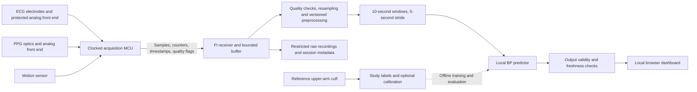

# Bad Blood: plan for a wearable blood-pressure estimator using Raspberry Pi

Prepared October 9, 2026, using repository evidence and primary sources reviewed October 8–9. This is an implementation and research plan. Proposed targets below are engineering goals, not measured results or clinical acceptance criteria.

**Recommendation:** retain the working Pi 4 inference system, add reliable synchronized ECG/PPG acquisition, establish accuracy on the actual wearable hardware, and then optimize size, memory and battery life. The current model is already fast enough for the planned five-second update interval. The main risk is whether its estimates remain useful when the sensors, placement, people and reference method change.

The working assumption is a research prototype with body-worn sensors and a nearby or belt-mounted Raspberry Pi. Start with seated measurements at rest. A single wrist-worn device, measurement during activity, and medical use require additional decisions and evidence. This plan assumes cuffless estimation because the existing system predicts BP from ECG and PPG; an inflatable wearable cuff would be a separate architecture.

## 1. What exists, and what needs to improve

| Area | Repository evidence | Implication |
|---|---|---|
| Model | Selected `cnn_full`, 37,666 parameters; two input channels, 1,250 samples each at 125 Hz | Preserve as the reference implementation; no accelerator is justified by present latency |
| Official calibration-free test | 144 people / 57,600 segments; SBP/DBP MAE **12.46 / 8.46 mmHg** | A functioning research estimator, with substantial accuracy work remaining |
| Broader-pressure evaluation | AAMI-designated subset MAE **19.34 / 13.17 mmHg**, bias **−12.74 / −9.31 mmHg** | Investigate systematic underestimation and pressure-range coverage; the subset name does not certify a device |
| Actual Pi evidence | Saved September 23 report: Pi 4B, p50/p95 **5.42 / 5.80 ms**, peak benchmark RSS **295,988 KiB ≈ 289 MiB**, 20/20 replay predictions matching release | CPU inference is a small part of the five-second interval; whole-system memory and power remain unmeasured |
| Acquisition | `WaveformSource` interface and recorded-data replay implemented; no physical sensor adapter | Live acquisition is the next major deliverable |
| Dashboard | Local waveforms, estimates, source labeling and stale-state clearing; inference independent of browser | Extend the existing UI and API |
| Validation | Participant-disjoint source split, fixed checkpoint, subject-bootstrap intervals, release/input tests | Keep these controls for every new model and sensor configuration |
| Local study | ND format, conversion code and collection procedure; no private participant data in this checkout | Gather representative hardware data before claiming transfer accuracy |

Evidence: [model description](../model%20training/PulseDB-based%20Model-V1/README.md), [complete error metrics](../model%20training/PulseDB-based%20Model-V1/reports/METRICS.md), [saved Pi evidence](../deployment/OMEN-Codex-Prompt/implementation/EVIDENCE_SUMMARY.json), [deployment status](../deployment/OMEN-Codex-Prompt/implementation/STATUS.md). These are repository records, not new hardware measurements made for this plan. Detailed Pi benchmark artifacts are not present in this checkout. Some older overview documents still describe Pi execution as future work; reconcile them with the newer evidence.

## 2. Target architecture and form factor

The MCU collects signals on a controlled timebase; the Pi handles buffering, quality assessment, preprocessing, inference, storage and the dashboard. Training remains on a workstation. A Pico is a microcontroller, not a drop-in replacement for the Linux Pi running the present Python application.

| Form factor | Advantages | Constraints and recommendation |
|---|---|---|
| ECG electrodes plus finger PPG; Pi nearby | Easier first integration, closer to the source signal sites | Best first live milestone; still requires verification of ECG lead, optics and preprocessing |
| Body-worn sensor assembly; belt/pocket Pi | Preserves local inference and allows practical wearable trials | Recommended second milestone; include cable strain relief, motion sensing and battery enclosure |
| Wrist sensor plus separate ECG electrodes | Moves optics to the target wrist location while preserving two channels | Requires new wrist data, timing verification and adaptation |
| Entire device on one wrist | Compact user experience | Electrode geometry, optical coupling, heat and battery dominate; requires a separate feasibility gate |

PulseDB used fingertip PPG and lead-II ECG. Wrist reflectance PPG and a different ECG lead are a domain change, even if array dimensions match. A watch-style ECG arrangement that requires touching another electrode provides spot recordings rather than automatic all-day ECG. Removing ECG requires a separately trained and validated PPG-only model; supplying a dummy channel is not acceptable. [PulseDB paper](https://www.frontiersin.org/journals/digital-health/articles/10.3389/fdgth.2022.1090854/full)

## 3. Hardware selection and acquisition

Reuse existing suitable hardware before buying new parts. Freeze a bill of materials only after confirming raw-data access, documentation, synchronization, placement, electrical protection and availability.

| Component | Candidate approach | Decision gate |
|---|---|---|
| Pi | Keep Pi 4B initially; consider Zero 2 W after profiling | Zero 2 W has 512 MB RAM; demonstrate memory headroom, compatible ARM64 packages and no swap dependency before migrating |
| ECG/PPG front end | Evaluate a supported board using a synchronous AFE such as MAX86176 | Confirm accessible firmware/register documentation, raw streams, external optics, electrode support and acquisition rates |
| Existing combined module | An already-owned MAX86150 board may support early experiments | ADI currently marks it Last Time Buy; do not base a new long-term design on it without a supply review |
| Acquisition MCU | Pico/RP2040-class board for an initial wired prototype; nRF52840-class board when BLE is required | Sensor FIFO servicing, reliable counters, low-power operation and documented synchronization matter more than MCU compute |
| Motion sensing | Three-axis accelerometer, optionally gyroscope | Start as a signal-quality input; adding it to the BP model requires a new training contract |
| Reference | Validated upper-arm cuff appropriate to the study population | Record model, cuff size, measurement procedure and reference checks |
| Power/mechanics | Protected battery pack, suitable regulator/charger, enclosure, strap and strain relief | Measure runtime, temperatures, fit, contact reliability and safe shutdown |

MAX86176 provides synchronous ECG/PPG paths and a FIFO, but it is an AFE requiring optics and system integration; complete documentation may require an NDA. An evaluation board is a practical feasibility tool, not evidence that the assembled system is approved for use on people. [ADI MAX86176](https://www.analog.com/en/products/max86176.html), [ADI MAX86150](https://www.analog.com/en/products/max86150.html), [Pi Zero 2 W](https://www.raspberrypi.com/products/raspberry-pi-zero-2-w/), [Nordic nRF52840](https://www.nordicsemi.com/Products/nRF52840), [Raspberry Pi microcontrollers](https://www.raspberrypi.com/documentation/microcontrollers/microcontroller-chips.html)

Acquisition requirements:

1. Use sensor data-ready interrupts/FIFOs and hardware timing. Linux polling intervals and USB/BLE packet arrival times must not define sample time.
2. Capture at a supported native rate appropriate to the selected hardware; evaluate 250–500 Hz where feasible, then anti-alias and resample to the V1 125 Hz interface. Higher native rates do not restore timing detail absent from V1 training.
3. Characterize channel offset, clock drift and sensor/filter delays with bench equipment. Set a timing budget before collection; an initial relative-timing target of at most 2 ms is a proposal to verify, not an existing capability. At 125 Hz, one sample is 8 ms.
4. Transmit protocol version, session/device ID, packet sequence, first sample counter/timestamp, actual rate, channel configuration, sample count, quality flags and integrity information. Detect resets, duplicates, missing packets, reordering and FIFO overflow.
5. Start with wired transport on the bench, then test BLE if needed. For human-connected recordings, use equipment and isolation appropriate to the approved procedure. Battery operation alone does not establish electrical safety; charging, USB and debugging connections must be included in the review.
6. Retain native raw values, units, gain, LED wavelength/current, polarity, electrode positions, firmware, temperature if available, and timebase mappings. Compute clipping and low-amplitude quality checks before normalization hides these properties.

Do not independently align ECG and PPG peaks to make traces look cleaner: that can remove physiological timing. ECG-to-PPG timing is pulse arrival time (PAT), containing the pre-ejection period as well as vascular transit; it must not be treated as a universally calibrated BP equation. Separate chest and wrist acquisition nodes also require a measured cross-device clock synchronization scheme. [Primary PAT study](https://pmc.ncbi.nlm.nih.gov/articles/PMC6912522/)

## 4. Software changes, in priority order

| Priority | Change | Existing integration point | Completion evidence |
|---|---|---|---|
| P0 | Versioned acquisition metadata and a real `DeviceSource` | `deployment/raspberry-pi/sources.py` | Device data reaches the unchanged V1 input boundary with traceable timestamps and counters |
| P0 | Source-age freshness and duplicate detection | `service.py`: `InferenceState` | Repeated old buffers never become fresh readings merely because inference ran again |
| P0 | Signal-quality gate before prediction | New quality module, called before `Predictor` | Electrode-off, saturation, low perfusion/contact, severe motion and dropped-data fixtures suppress BP |
| P0 | Suppress invalid output and separate health states | `service.py`, `web/app.js` | `SBP <= DBP` produces unavailable BP; process liveness and measurement readiness are distinct |
| P0 | Shared, explicitly versioned preprocessing | V1 `common.py`, `convert_nd.py`; new live processing module | Replay of a captured raw stream matches the deployed processing path |
| P1 | Acquisition independent of inference | New receiver/buffer module | Slow inference or browser requests cannot stop sample collection |
| P1 | Bounded queues, source timeouts and watchdog | `service.py`, service template | Disconnects and hung acquisition recover or remain explicitly unavailable |
| P1 | Metadata, retention and reproducible recording | New recorder/session schema | Raw data, references and predictions join by IDs; private data stays outside Git |
| P1 | Compatible, versioned deployment bundle | `app.py`, V1 `inference.py`, model manifests | Model, preprocessing, channel/rate contract and calibration versions are verified together; incompatible bundles fail before serving |
| P1 | Whole-system performance/power benchmark | Extend `run_pi_checks.py` | Includes acquisition, filtering, UI load, memory, temperature and energy |
| P1 | Wearable UI states and recovery | Existing web assets | Clear warming-up, poor-contact, motion, disconnected, stale and ready states |
| P2 | Lightweight inference runtime | `Predictor` backend boundary | Measurable resource benefit with preserved accuracy and rollback |

Specific current behavior to address: `SignalWindow` has no acquisition timestamps; `InferenceState.publish()` determines freshness from publication time. `next_window()` can block without a timeout. `review_prediction` currently retains an inverted SBP/DBP pair and counts as healthy. These are live-device correctness risks, even though recorded-data replay works.

Use a bounded ring buffer long enough for the ten-second window plus any filter context. Schedule windows by acquisition sample count, with a 625-sample stride at 125 Hz. Reject windows spanning unexplained gaps, sensor resets or configuration changes. After reconnecting, wait for a full valid window and filter warm-up. If processing falls behind, explicitly drop obsolete windows and record that event; do not accumulate increasingly stale predictions.

Record `window_start`, `window_end`, publication time, model/preprocessing versions, device session, quality status and calibration version. Freshness should derive from the acquisition window end through a verified clock mapping. Use monotonic time for timeouts; UTC supports records and display. Continue to distinguish replay from live input. A five-second refresh summarizes the preceding ten seconds and is not an instantaneous or beat-to-beat measurement.

Keep local inference independent of the browser and internet. Retain loopback/SSH access during development. If phone access becomes necessary, add authenticated local access and a defined pairing process; do not simply expose the present development server on every interface. Use a non-root service, controlled device permissions, bounded logs, restricted recordings and recoverable storage. Test service termination and restart behavior explicitly: `Restart=on-failure` cannot detect every stuck acquisition thread by itself. Serialize browser polling or make updates sequence-aware so a late response cannot replace newer state; include a boot/session ID to distinguish sequence resets.

## 5. Preprocessing and signal-quality validation

V1 training consumes already-filtered PulseDB signals. `common.from_raw_125()` applies window-local zero-phase filtering: ECG Butterworth 0.5–40 Hz; PPG Chebyshev II 0.5–8 Hz, followed by independent min-max normalization. The collection manual explicitly says this does not prove equivalence to the source filter chain.

Choose and document one of two paths:

- **First live baseline:** process each complete ten-second window with the existing adapter. It can execute after the window is collected, but boundary effects and mismatch with source filtering still need measurement.
- **Improved streaming path:** retain causal filter state or use explicitly buffered context and a defined delay. This changes the signal representation; version it and reproduce it in training/evaluation before replacing the baseline.

For both, quantify frequency response, phase/channel delay, startup behavior, clipping response, motion artifacts, and effects at window edges. Account for filtering already performed by the sensor. Avoid double filtering converted ND data. Preserve the existing V1 implementation so differences can be traced.

Quality checks should combine raw amplitude/saturation, contact/lead-off, missing samples, waveform morphology, agreement of detected ECG/PPG beat rates and accelerometer motion. Fit thresholds on development recordings. A numeric input check is not a signal-quality certificate, and a clean waveform does not establish BP accuracy.

Report usable-reading coverage alongside error. A model that improves MAE by discarding most difficult recordings may be less useful. Freeze quality thresholds before final evaluation and report rejection rates by person, session, placement and relevant participant groups. Show a specific reason when a reading is unavailable; never carry forward an old BP as a fresh result. Display calibrated uncertainty only after validating its coverage on held-out people and later sessions.

## 6. Data collection, calibration and model improvement

Use the existing [ND contract](../data/nd/README.md) and [collection procedure source](../data/Data%20Collection%20Manual/Data_Collection_Manual_EN.tex) as the starting point. Resolve hardware safety and study approvals before collecting from people. The first small engineering pilot should debug contact, timing, file joins and failure logging; it should not be advertised as an accuracy study.

The existing research design is 40 development participants and 10 final-test participants, with three paired cycles at each of two visits 3–14 days apart. That provides **300 planned cuff-paired records before exclusions, clustered within 50 participants and 100 visits**; permitted repeat attempts are logged separately. Repeated records from a person are correlated; continuous windowing does not create additional independent participants or cuff references. This design supports feasibility and simple adaptation; it is small for training a deep network from scratch or establishing subgroup performance.

For each pair, preserve the ten-second pre-inflation window as specified by the manual, the continuous recording, cuff event times, reference result, visit/cycle IDs and failures. A subsequent cuff reading is not simultaneous ground truth for every preceding or following second; document the pairing interval and resulting label limitation. Avoid using cuff-disturbed optical data. Do not assign one cuff result indiscriminately across long recordings or treat overlapping windows as independent reference measurements.

Split by person before fitting preprocessing, quality thresholds, model parameters or calibration rules. Within personalized experiments, use earlier visits for calibration and later visits for testing. Group repeated windows by session/cuff event. If source training is expanded, exclude all participants belonging to the locked source test sets. Previously examined test results remain historical benchmarks; a new prospective holdout is needed for an unbiased final V2 claim.

Run experiments in this order:

| Order | Experiment | Why it earns priority |
|---|---|---|
| 1 | Frozen V1 on accepted real-device recordings | Measures actual transfer failure before adding complexity |
| 2 | Training-mean, development-trained simple model and last-calibration-cuff baselines | Tests whether waveforms add useful information beyond typical or recently measured BP |
| 3 | Development-fitted global residual correction | Tests simple systematic sensor/domain bias correction |
| 4 | Optional per-person offset from a fixed number of early cuff pairs | Tests practical personalization; label this as calibration-dependent |
| 5 | Freeze backbone and fit a small head/residual model | Better suited to a small local dataset than unrestricted deep fine-tuning |
| 6 | Limited fine-tuning, realistic noise/motion augmentation, BP-range/participant-balanced sampling | Attempt only if simpler methods fail and development data support it |
| 7 | Modality ablations: ECG-only, PPG-only, both; timing/morphology features | Measures whether ECG hardware and PAT features justify their complexity |
| 8 | More representative participants, additional sessions and external-device cohorts | Addresses generalization; new architectures alone do not resolve missing coverage |

Use participant-grouped development cross-validation for selection. Compare source-only, ND-only and adapted models on the same eligible final records, with uncertainty intervals. For a calibration comparison, give each eligible participant the same predefined early calibration budget and evaluate on identical later records; the personalized result must not be labeled calibration-free. Include a last-cuff baseline on those later records. Lock calibration expiry rules from observed drift, not an assumed daily or weekly interval.

Report SBP and DBP MAE, signed bias, error SD, RMSE, percentages within 5/10/15 mmHg, participant-macro error, worst-participant distributions, BP-range strata, quality coverage and subject-bootstrap intervals. Add repeated-measures-aware agreement plots and within-person change tracking; correlation alone is insufficient. Inspect high/low-pressure error rather than clipping outputs into a normal range. Evaluate relevant skin tones, ages, sex, fit, posture, sensor placement and session gaps where sample sizes permit; label sparse groups as inconclusive.

Proposed development promotion gate: at matched usable coverage, achieve at least a 20% reduction in the average of SBP/DBP participant-macro MAE versus frozen V1 on real-device development folds, without material deterioration in either target or pressure extremes. Predeclare the practical deterioration margin before running comparisons. Require evidence of benefit over the simple/calibration baselines too. A stretch research objective is MAE at or below 8/5 mmHg in the defined resting use case; it is not a clinical certification threshold or a promised result. Failure to meet a gate should trigger a narrower claim, improved sensing or more data.

## 7. Compute, power and physical optimization

Profile the complete system first. The saved 5.8 ms p95 measurement covers the prepared-window predictor, not sensing, filtering, transport or display. Time data receipt, preprocessing, inference, publication and UI delivery separately; record p50/p95/p99, queue depth, CPU, RSS, temperature, throttling, voltage and average/peak power under realistic loads.

Optimize in this order:

1. Benchmark one, two and four inference threads; `Predictor` currently forces four. Select using energy and deadlines, not isolated throughput.
2. Use a headless OS, bounded logging, batch writes, appropriate radio duty cycle and one loaded model. Downsample only display traces if necessary; keep full model inputs.
3. Compare current PyTorch with an FP32 ONNX Runtime export on the target OS/CPU. Verify supported operators and installable packages before choosing a runtime.
4. Consider static INT8 quantization if measurements show a useful benefit. Use representative development signals for quantization calibration, never final-test labels/windows for tuning. Conv1D, residual connections and SiLU may affect kernel support and realized gains. ONNX Runtime recommends static quantization for CNNs; benchmark rather than assume a fourfold whole-system saving. [ONNX Runtime quantization guide](https://onnxruntime.ai/docs/how-to/quantization.html)
5. Migrate to Pi Zero 2 W only after demonstrating headroom with the full service. Pruning, distillation and accelerators are later experiments if memory/power targets remain unmet.

Preserve the existing FP32 golden prediction tolerance of 0.01 mmHg for equivalent runtime exports. Quantization may require a separate predeclared tolerance: a proposed starting gate is no more than 0.5 mmHg degradation in either target's participant-macro MAE on development data, with pressure-range and coverage checks. Do not loosen tolerance after seeing final-test results.

Size the battery from measured watts:

`runtime_hours = battery_Wh × measured_conversion_efficiency × usable_fraction / average_load_rail_W`

Illustration only: a 3.7 V, 3 Ah pack is 11.1 Wh; at 85% conversion efficiency and 80% usable capacity, it supplies about 7.55 Wh at the load rails. At 2 W average rail load that is about 3.8 hours. An eight-hour target would require a larger pack or lower measured power. Include the Pi, optics, MCU and radios in the rail load; efficiency accounts for regulator losses. If measuring watts directly at the battery instead, omit the separate efficiency factor to avoid counting conversion losses twice. Battery label mAh alone is insufficient.

Separate the warm Pi/battery assembly from the skin-contact optics where practical. Assess strap pressure, ambient-light shielding, contact consistency, sweat, motion, cable movement, skin compatibility, enclosure temperature and emergency removal. An IMU can help flag movement/posture but cannot alone determine wrist height relative to the heart. Avoid automatic hydrostatic correction without a validated height measurement.

## 8. Acceptance gates and realistic sequence

All thresholds in this table are proposed project targets to freeze before testing. They do not substitute for a formal medical-device protocol.

| Gate | Required evidence |
|---|---|
| G0 — Reproducible baseline | Archived model/split/preprocessing manifests; release checks; recoverable Pi evidence; current documentation |
| G1 — Acquisition | Two-hour simulator/bench run with every gap detected, no silent corruption, measured channel timing within the agreed budget and bounded buffers |
| G2 — Live integrity | Correct ten-second/five-second windows; stale/duplicate/dropped/reset/motion/lead-off fixtures cannot publish valid BP; raw-to-live replay agreement |
| G3 — Wearable feasibility | Approved pilot demonstrates stable contact and at least 80% usable windows in the predefined resting task; report participant variability and causes of rejection |
| G4 — Accuracy | Locked prospective evaluation reports all prescribed errors and coverage; comparison against source and simple baselines; no retuning on final subjects |
| G5 — Runtime | Proposed p95 window-end-to-publication latency below 1 second, no sustained queue growth, memory headroom of at least 25% on selected hardware, no sustained swapping or thermal throttling |
| G6 — Robustness/power | Eight-hour end-to-end soak and measured battery target; disconnect/reconnect, browser loss, disk-full, process crash, clock change and controlled power-loss tests; no stale BP displayed as current |
| G7 — Handoff | Frozen software/firmware/BOM, installation/recovery instructions, dataset/model cards, limitations, results and reproducible demo |

Initial sampling/filter warm-up can delay the first estimate beyond ten seconds. The latency gate applies after a valid window exists and includes any required buffering. Define freshness expiry from actual acquisition timing; the current 12-second service timeout is only an existing baseline.

Indicative schedule for two to three contributors with available hardware and study access:

| Relative time | Work and owner | Exit |
|---|---|---|
| Week 1 | All: confirm use case, inventory, signal placement, budget, data protocol and acceptance targets; software: archive baseline | G0 and feasible sensor choice |
| Weeks 2–3 | Hardware/firmware: acquisition protocol, timing bench tests; software in parallel: buffers, metadata and failure fixtures | G1 |
| Weeks 4–5 | Software + hardware: real source, preprocessing, quality gates, UI states and recovery; study lead: approved engineering pilot | G2; assess G3 |
| Weeks 6–9 | Study/data lead: prospective paired recordings and return visits; ML: development-only baseline/adaptation comparisons; embedded: power profiling | Dataset and candidate frozen |
| Weeks 10–12 | ML: locked evaluation; embedded/software: runtime, battery, reliability and fit iteration | G4–G6 or documented failure/next experiment |
| Weeks 13–16 | Team: resolve failures, final packaging, repeat affected checks and handoff | G7 |

This is an engineering estimate, not a promise of clinical readiness. Procurement, ethics review, recruitment, repeat visits and sensor performance can dominate the schedule. A solo developer should expect longer. Keep clinical validation and commercialization outside this prototype timeline.

Budget separately for sensing/evaluation hardware, MCU/radio, reusable Pi, reference cuff, battery/power instrumentation, electrodes/consumables, enclosure iterations, study operations and any PCB work. Obtain current quotes after the sensor decision, reserve 20–30% engineering contingency, and reuse lab instruments. Bare-chip prices do not estimate the cost of a complete safe wearable. Avoid spending on a custom PCB before sensor placement and signal usefulness pass G3.

## 9. Clinical scope, risks and decisions

The initial output should be described as a research BP estimate. The current errors and absent wearable validation do not support diagnosis or medication decisions. FDA's September 2025 communication warns about unauthorized BP devices. Its January 2026 cuffless performance guidance remains explicitly **draft and nonbinding** on the official page reviewed for this plan. If medical use is intended, involve clinical and regulatory specialists early to define intended use, reference method, populations, risk controls and the applicable validation pathway. [FDA safety communication](https://www.fda.gov/medical-devices/safety-communications/do-not-use-unauthorized-devices-measuring-blood-pressure-fda-safety-communication), [FDA draft guidance](https://www.fda.gov/regulatory-information/search-fda-guidance-documents/cuffless-non-invasive-blood-pressure-measuring-devices-clinical-performance-testing-and-evaluation)

Formal validation must address the actual use case, including calibration stability, posture, activity and pressure changes when claimed. A small seated cuff-comparison study or a PulseDB subset named AAMI is not sufficient evidence for an ambulatory claim. Mean signed error, error SD and MAE are different metrics; passing a chosen MAE target does not establish compliance. The AHA identifies motion, positioning, posture and hydrostatic effects as major challenges for cuffless devices. [AHA scientific statement summary](https://professional.heart.org/en/science-news/cuffless-devices-for-the-measurement-of-blood-pressure)

| Major risk | Response / decision trigger |
|---|---|
| Wrist or electrode change degrades accuracy | Recollect at final placement; adapt on development data; retain a narrower resting use case if needed |
| Sensor timing/filter mismatch | Bench characterize before data collection; version the entire acquisition/preprocessing chain |
| Personal calibration appears accurate only immediately afterward | Evaluate later sessions and against last-cuff baseline; measure drift and recalibration burden |
| Low error achieved by rejecting too many people/windows | Publish coverage and rejection distributions; compare at matched coverage |
| Hardware costs/power exceed wearable target | Keep Pi external or belt-mounted; evaluate lightweight runtime and smaller board after profiling |
| Existing two-channel setup cannot fit the desired wrist design | Choose spot ECG contact, separate ECG electrodes or a new PPG-only research branch |
| Dataset expansion creates leakage | Audit participant/session overlap before training and preserve an untouched prospective holdout |
| Product ambitions conflict with source-data permissions | Review PulseDB-derived data/license terms before commercial distribution; preserve attribution and separate private study records |

The decisions still needed are the exact Pi/sensors already owned, intended placement, whether ECG electrodes are acceptable, spot versus unattended use, research versus medical purpose, required runtime, budget and deadline. Until those are fixed, the practical default is **synchronized ECG plus finger PPG → acquisition MCU → existing Pi 4 → quality-gated local estimates**, followed by validation at the final wearable location.

## 10. First implementation backlog

1. Reconcile overview documents with saved Pi evidence and preserve a V1 baseline manifest.
2. Specify the live sample packet, acquisition timestamps, clock mapping and session configuration schema.
3. Extend `SignalWindow` metadata and service freshness; add duplicate/gap/reset handling while retaining replay behavior.
4. Implement an instrumented raw-stream replay source and bounded window builder before connecting physical sensors.
5. Implement quality/output gating and explicit unavailable states; fix the current inverted-prediction health behavior.
6. Bench-verify the chosen acquisition hardware, then add its driver at the existing source boundary.
7. Freeze preprocessing and the pilot protocol; capture and replay complete raw sessions.
8. Compare frozen V1, simple corrections and calibration baselines using participant/session-safe evaluation.
9. Profile the full wearable pipeline and battery; optimize only the measured constraints.
10. Freeze the candidate, execute the final evaluation and publish the evidence with precise limitations.

The first demonstrable success is a live, traceable, synchronized recording that produces an estimate only when the data are fresh and usable. Demonstrating useful BP accuracy on the intended wearer population is the next independent success criterion.
